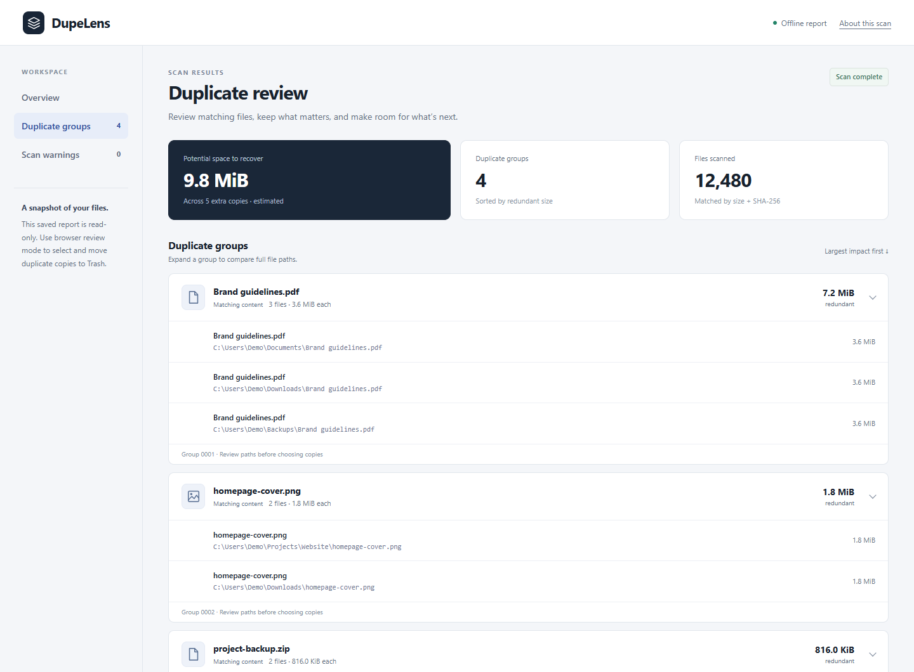
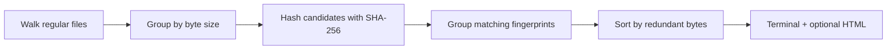

<div align="center">

# DupeLens

### Find the copies. Keep control.

**Find duplicate files with a read-only CLI, or review copies in a local browser workspace. Zero runtime dependencies.**


</div>

```text
$ java -jar dupelens.jar ./downloads --html report.html

Scanned 5 files | 1 duplicate groups | 4 redundant bytes

4 bytes each (2 copies)
  /downloads/copy.txt
  /downloads/original.txt

Report: /reports/report.html
```

## Preview

<p align="center">
  
</p>

## Why DupeLens?

Backups, downloads, and exported folders accumulate copies. DupeLens shows matching contents, sorted by redundant bytes. The CLI and saved reports are read-only. A separate browser-review app can move selected copies to Recycle Bin/Trash after confirmation.

- **Read-only CLI:** no delete command, no automatic cleanup. Deletion exists only in the separate review app.
- **Size-first filtering:** only files with a matching size are hashed.
- **SHA-256 fingerprints:** matching names alone never count as duplicates.
- **Bounded hashing memory:** streams files in 64 KiB chunks.
- **Portable reports:** one HTML file, no server, scripts, fonts, or network calls.
- **Hard-link awareness:** excludes repeated file identities when the filesystem provides them.
- **Practical failure handling:** unreadable files become warnings, and symbolic links are skipped.
- **Explicit review actions:** choose keepers, review selected paths, then confirm a move to Trash. Nothing is automatically selected for deletion.

## Quick start

Requires a **JDK 17 or newer**. Maven is optional.

Download either runnable JAR and its SHA-256 checksum from [GitHub Releases](https://github.com/illusionoftalha/dupelens/releases):

- `dupelens-1.2.1.jar`: read-only scans and saved HTML reports.
- `dupelens-review-1.2.1.jar`: local browser review with optional, confirmed moves to Trash.

See [CHANGELOG.md](CHANGELOG.md) for release notes.

```sh
# Run directly from source; no build tools required
java src/main/java/dev/dupelens/Main.java ./your-folder

# Generate a report (choose a path that does not already exist)
java src/main/java/dev/dupelens/Main.java ./your-folder --html report.html
```

Or build a runnable JAR:

```sh
mvn package
java -jar target/dupelens.jar ./your-folder --html report.html
```

Quote paths containing spaces. On Windows, for example:

```powershell
java -jar target/dupelens.jar "C:\Users\YourName\Downloads" --html "duplicates.html"
```

Reports include a scan summary and expandable duplicate groups with full paths. Saved reports work offline with no JavaScript or external assets. Use the sidebar to navigate and expand a group with a click or the keyboard.

The report refuses to overwrite existing files. Reports contain full local paths; review them before sharing.

## Browser review and deletion

On Windows, from the folder containing the review JAR:

```powershell
java -jar .\dupelens-review-1.2.1.jar "C:\Users\YourName\Downloads"
```

Or build locally and run `java -jar target/dupelens-review.jar ./your-folder`.

After scanning, DupeLens opens a private local URL in your browser (or prints the URL if automatic opening is unavailable). Keep the terminal running; press Ctrl+C to end the session. Review uses JavaScript and connects only to the Java process on `127.0.0.1`. There are no remote services or telemetry.

1. Expand a group and compare full paths. Use **Keep** to protect your preferred copy.
2. Check unwanted copies, or click **Select other copies** in that group. Use **Select all extra copies** to select unwanted copies across every group, including those hidden by search. Each group's chosen keeper stays protected. Nothing is selected initially.
3. Click **Delete selected**, review the exact files and matching retained copies, then confirm **Move to Trash**. Cancel leaves files untouched. Large selections are processed sequentially in requests of up to 500 files after this confirmation. If a request fails, processing stops; reload and check the action log before retrying.
4. Check the result and download the session CSV action log if needed. Logs are held in memory until the app closes.

A saved `file://` HTML report cannot delete arbitrary local paths: browsers intentionally block that access. Start the review JAR to enable deletion; the CLI's `--html` output stays read-only.

### How moving files stays safe

The backend accepts only file IDs from the current scan, refuses selections that leave no available keeper, and processes operations serially. Immediately before each move it checks both copies' size, modification time, file identity, and resolved path, compares their contents byte-for-byte without following final-component symlinks, and checks metadata again. Changed, unavailable, or mismatched files are skipped and reported. There is no permanent-delete fallback.

Trash support depends on the OS/JDK and desktop session. If Java reports it unsupported, deletion is disabled with a reason. The review process binds only to loopback and validates the host, origin, and a per-session request token. Keep its private URL to yourself.

Filesystem changes and Trash operations are not atomic. Close applications modifying scanned files and rescan after external changes; a file could still change in the short interval between verification and the native Trash operation. Trash behavior and restoration depend on your system. No image-similarity matching is performed.

If a Windows JDK reports `Unable to establish loopback connection`, try a writable socket directory (the current folder must be writable):

```powershell
java "-Djdk.net.unixdomain.tmpdir=$PWD" -jar .\dupelens-review-1.2.1.jar "C:\Users\YourName\Downloads"
```

## How it works



A group with three 10 MB files has 20 MB of redundant contents. This is an estimate, not a promise of physically reclaimable disk space: compression, deduplication, snapshots, and filesystem allocation can change actual usage. Empty files are included with zero redundant bytes.

The scanner checks size, modification time, and file identity around hashing to catch ordinary concurrent edits. It is not an atomic filesystem snapshot; scan a stable folder for reliable results. Matching hashes are not followed by a byte-by-byte comparison. Directory metadata scales with file count, and scanning large matching files can take time. Hard-link detection depends on filesystem file-key support.

## Tests

The integration checks use temporary directories and require no test libraries:

```sh
sh scripts/test.sh
```

```powershell
./scripts/test.ps1
```

Checks cover identical contents, different contents with equal sizes, empty files, hard links where supported, missing directories, HTML escaping, preservation of scanned files, keeper protection, stale files, byte verification, Trash refusal, session state, and HTTP request validation. Review tests use a fake Trash that moves isolated temporary fixtures; they never call native Trash or touch user files. GitHub Actions is configured for Java 17 and 21 on Linux, macOS, and Windows.

## Contributing

Small, focused contributions are welcome. See [CONTRIBUTING.md](CONTRIBUTING.md) for the development workflow. Useful next steps include exclusion patterns, machine-readable output, and cancellation support for long scans.

If DupeLens helps you understand your storage, a star helps others discover it.

## License

[MIT](LICENSE)
